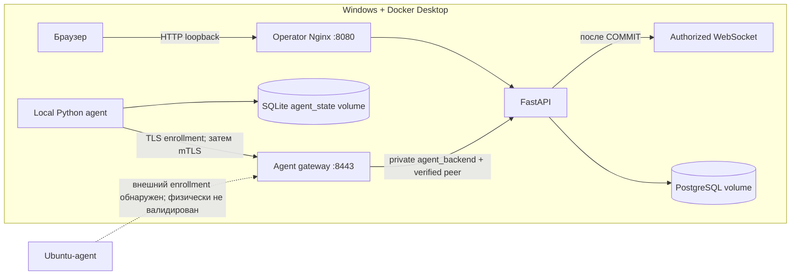
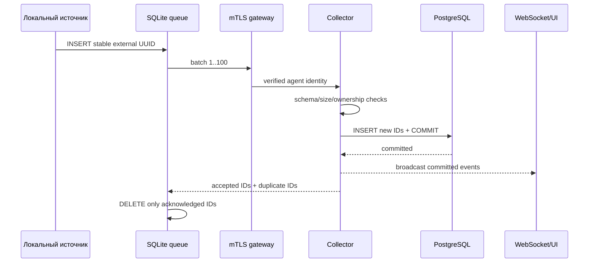
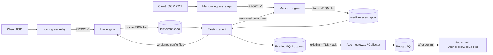
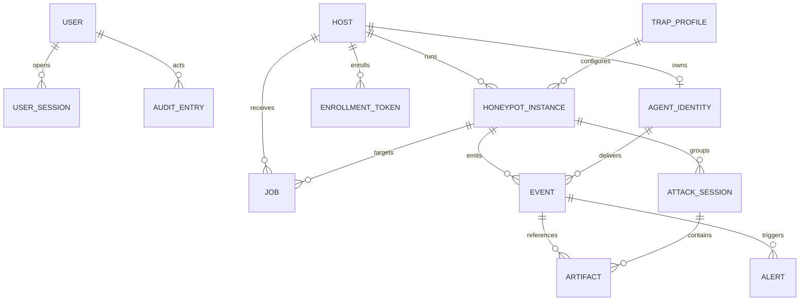

# Архитектура HoneyForge

## Состояние после MASK P0

Центр состоит из двух раздельных входных контуров, FastAPI и PostgreSQL. Операторский Nginx публикует HTTP UI только на `127.0.0.1:8080` и явно блокирует `/agent/`. Agent gateway публикует TLS на `127.0.0.1:8443`: enrollment допускается без клиентского сертификата только с одноразовым token, остальные agent routes требуют сертификат локального CA. API и PostgreSQL не публикуются на Windows.

Python-agent работает в отдельном Compose-профиле. Он не получает Docker socket, `privileged` или административную сессию оператора. Low/Medium runtime и опциональный High SSH/HTTP-эмулятор работают отдельными контейнерами; реальные engine events имеют `is_test=false`, а контролируемые локальные проверки дополнительно помечаются `data.controlled_test=true`.

## Регистрация и идентичность

1. Admin/operator создаёт host + trap instance и одноразовый token с TTL 1–60 минут. В БД хранится только SHA-256 token.
2. Агент локально создаёт EC P-256 private key и CSR. Private key остаётся только в persistent agent volume.
3. Enrollment endpoint под TLS атомарно блокирует строку token, проверяет срок, `used_at` и отсутствие identity для host.
4. Центр подписывает client certificate локальным CA, создаёт `agent_identities` и помечает token использованным в одной транзакции.
5. Агент сохраняет certificate/identity и удаляет bootstrap token file. Повторное использование возвращает conflict.

`agent_identities` отделена от operator users/sessions и привязана ровно к одному host. При приёме события центр получает identity из проверенного client certificate и разрешает только instance, принадлежащие этому host.

## TLS, mTLS и pinning

- Server certificate содержит SAN `agent-gateway`, `localhost`, `127.0.0.1`; TLS 1.2/1.3, session tickets отключены.
- Агент одновременно проверяет локальный CA, hostname и SHA-256 SPKI pin server key. Ни один из этих checks не отключается.
- После enrollment Nginx требует client certificate локального CA. FastAPI дополнительно сопоставляет fingerprint/serial с активной DB identity и проверяет expiry/revocation state.
- CA key доступен только API через read-only bind mount; server key — только gateway; agent key — только agent volume. `secrets/`, `.env` и test artifacts исключены из Git и не входят в build context.
- Реализован аутентифицированный endpoint перевыпуска сертификата. Автоматическое обновление до expiry, overlap старого/нового сертификатов, CRL/OCSP и операторский revoke/rotate UI ещё не реализованы.

Подробный lifecycle: [`agent-security.md`](agent-security.md).

## Конфигурации и heartbeat

Профиль имеет монотонную `config_version`, увеличиваемую при update. Агент периодически получает все instance/profile своего host и сохраняет последнюю версию в SQLite. Heartbeat обновляет `Host.last_seen_at`; при авторизованном чтении host старше configured threshold переводится в `offline`. Trap instance не переводится в `online`, пока нет настоящего движка ловушки.

## Доставка событий

Event payload ограничен 16 KiB, batch — 100 событиями и 512 KiB. `external_id` уникален в PostgreSQL. Повторная доставка возвращается как duplicate acknowledgement, поэтому очередь безопасно удаляет её без повторной строки. REST поддерживает фильтры instance/time/source/type. WebSocket требует operator session cookie, выдаёт backlog по cursor времени и затем live events; браузер удаляет повторы по external ID.

При сетевой ошибке агент не удаляет очередь, использует bounded exponential backoff с jitter и продолжает создавать явно синтетические test events только если включён test interval. SQLite использует WAL + `synchronous=FULL` на persistent volume.

## Задания

Job содержит UUID, host/optional instance, структурированные `command`/`payload`, state, unique idempotency key, attempt count, delivery/ack timestamps и result. Агент хранит обработанные job IDs в SQLite до acknowledgement. Поддерживаются только встроенные handlers `apply_config`, `start_trap`, `stop_trap` и `collect_status`; неизвестные команды завершаются `failed`. Shell executor отсутствует. Lifecycle job отмечается `succeeded` только после status нужной версии от фактического Low/Medium/High runtime.

## Compose и trust boundaries

| Контур | Доступ | Хранилище/ограничение |
|---|---|---|
| operator `nginx` | `127.0.0.1:8080`, HTTP | `/agent/` → 404 |
| `agent-gateway` | `${AGENT_BIND_IP:-127.0.0.1}:8443`, TLS/mTLS | только `/agent/v1/*`; read-only root; минимальные capabilities; только server key + public CA |
| `api` | без host port | `edge` + internal `data` + internal `agent_backend`; только CA certificate/key для выдачи client certificate |
| `db` | без host port | existing `postgres_data`, internal `data` |
| `local-agent` profile | только internal `agent_channel` | `agent_state`, cap-drop ALL, no-new-privileges, no socket |
| `tests` profile | без host ports | отдельные `postgres_test_data` и `test_data` |

Agent gateway и FastAPI связаны отдельной сетью `agent_backend`, помеченной `internal`. Operator Nginx и остальные center-контейнеры к ней не подключены. Gateway дополнительно входит в выделенную `agent_ingress`, необходимую Docker Desktop для публикации host-port, и в локальную `agent_channel`; ни одна из этих сетей не даёт прямого доступа к FastAPI agent routes.

FastAPI запущен с `--no-proxy-headers`. Перед доверием к `X-HoneyForge-*` он сверяет реальный TCP peer с адресом DNS-имени `agent-gateway` в общей private-сети; запрос с поддельными заголовками из operator-сети получает 404. Nginx перезаписывает, а не наследует agent identity headers. Публичного `/agent-health` больше нет: Docker healthcheck обращается к отдельному listener `127.0.0.1:8080/internal-health` внутри gateway-контейнера.

Gateway использует read-only root filesystem, `no-new-privileges`, `cap_drop: ALL` и whitelist `CHOWN`, `DAC_OVERRIDE`, `SETGID`, `SETUID`, необходимый stock Nginx для чтения bind-mounted key с mode `0600` и запуска worker-процессов. Writable paths ограничены tmpfs для runtime/cache. `ca.key` отсутствует в mounts и filesystem gateway.

## MASK P1-A: внешний профиль Agent Gateway

Успешный протокол зарегистрированных агентов по `/agent/v1/*` не изменён. GET `/` возвращает короткую нейтральную HTML-страницу без названия продукта. Неизвестные маршруты, неверные методы, Nginx request errors и обращение к защищённому маршруту без client certificate приводятся к одинаковому 404 body без описания TLS/mTLS, backend framework или внутренних путей. Значимые ответы приложения на корректных agent-запросах сохраняют прежние HTTP status и JSON, если они не являются Nginx 400/404/405.

Gateway скрывает backend `Server`, `X-Powered-By` и внутренние `X-HoneyForge-*` response headers. Stock Nginx продолжает добавлять собственные `Server: nginx` и `Date`; версия отключена через `server_tokens off`. Полное удаление этих встроенных заголовков потребует другого proxy build/module и в P1-A не выполнялось.

Дополнительный transport alias задаётся `AGENT_TRANSPORT_PREFIX` с безопасным default `/assets/runtime`. Gateway преобразует `${AGENT_TRANSPORT_PREFIX}/v1/*` во внутренний `/agent/v1/*`; FastAPI API и хранилища не дублируются. Protected alias использует тот же `$ssl_client_verify`, private backend и FastAPI identity verification; alias enrollment использует тот же TLS + one-time token flow. Старый `/agent/v1/*` остаётся активным, и `ubuntu-lab-02` на alias не переключался. Значение prefix должно начинаться с `/`, не иметь завершающего `/` и не пересекаться с `/agent`; ошибочная конфигурация должна быть отвергнута `nginx -t` до развёртывания.

## MASK P1-B: transport-клиент агента

Agent transport принимает только `/agent` и `/assets/runtime`; для новых агентов default — `/assets/runtime`, а `/agent` сохранён для совместимости. Настройка `RUNTIME_TRANSPORT_PREFIX` принадлежит клиенту канала управления и не входит в trap profile. Один долгоживущий `httpx.Client` обслуживает heartbeat, config, jobs, status, events, job ack и certificate rotation. Pool ограничен двумя соединениями/одним keep-alive, default expiry 60 секунд — больше максимальной задержки heartbeat.

CA validation, hostname `agent-gateway` и SPKI pin применяются к одному фактическому TLS stream. Custom `httpcore.NetworkBackend` проверяет pin в `start_tls()` до HTTP; каждый reconnect снова проходит проверку. Redirects отключены. После transport error повреждённый client/pool закрывается, а следующий цикл создаёт новый — POST не повторяется немедленно, поэтому неопределённый результат events остаётся в SQLite и разрешается существующим external-ID dedup/ack механизмом.

Heartbeat default не изменён: 15 секунд с jitter ±15%, то есть 12,75–17,25 секунды. Допустимые настройки ограничены interval 1–30 секунд и jitter 0–25%; это ниже center offline threshold 90 секунд. Retry/backoff и порядок SQLite queue не менялись.

## Разделённые Compose-проекты этапа 4.1

- `compose.center.yaml` — Windows control plane с прежним project name `honeyforge`: PostgreSQL, API, operator Nginx, agent gateway и изолированный test profile. `AGENT_BIND_IP` имеет default `127.0.0.1`.
- `compose.ubuntu-agent.yaml` — отдельный project name `honeyforge-ubuntu-agent`: новый agent state/bootstrap volume, Low/Medium engines, опциональный High engine, раздельные event/config volumes и ingress relays. В нём нет center services и нет ссылки на Windows `agent_state`.
- `compose.yaml` сохранён как совместимый локальный Windows-стенд; существующие команды, service names и volumes не меняются.

Ubuntu-agent разрешает имя `agent-gateway` в конкретный `HONEYFORGE_CENTER_IP` через Compose `extra_hosts`. URL остаётся `https://agent-gateway:8443`, поэтому TLS проверяет SAN `agent-gateway`; дополнительно остаются CA chain и SPKI pin. Подстановка IP не отключает hostname verification и не требует добавлять Windows IP в server certificate.

Одна `agent_identity` по-прежнему принадлежит одному `Host`, но host может иметь несколько `HoneypotInstance`. Admin/operator добавляет экземпляры через `POST /api/v1/traps` или UI `/traps/new`; agent `/config` получает все экземпляры своего host, а Collector проверяет ownership каждого события. На одном host нельзя назначать двум экземплярам одинаковую пару protocol/port.

Low/Medium/High engines находятся только в своих internal networks. Agent не разделяет с ними сеть и обменивается только config/event volumes. Ingress relay не получает PKI, agent state или Docker socket. Физический firewall и отдельный trap-facing интерфейс всё равно обязательны: Docker port publishing само по себе не является egress isolation.

## Непроверенная граница

Этапы 2–3 доказывают защищённый протокол и локальную контейнерную изоляцию только в Docker Desktop на Windows. Ни один Ubuntu-ноутбук не подключался. Не проверены физические интерфейсы management/trap, маршруты, ACL/firewall, отсутствие production egress, packet capture и маскировка всего стенда. Наличие mTLS и internal Docker networks само по себе не является доказательством сетевой изоляции или скрытности физического стенда.

Артефакты/session recordings, fake DB, High с настоящей sandbox-ОС и проверенное Ubuntu-развёртывание остаются следующими этапами. Реализованный High использует только виртуальную неизменяемую ФС и интерпретатор allowlist-команд: он не является выполнением бонуса FR-A5. Код не выполняет enrollment/LAN/firewall операции.
## Дополнение этапа 3: Low/Medium runtime

Этап 3 добавляет два движка, не меняя trust boundary этапа 2 и не создавая второй канал телеметрии.

### Движки

Low принимает TCP-сервисы из профиля. Для service name `http` он разбирает и сохраняет запрос и отдаёт простой HTTP response с настроенным banner; для остальных TCP-сервисов отдаёт banner и безопасный статический ответ. Ограничение одного запроса — 8 KiB.

Medium принимает только `http` и `ssh`. HTTP эмулирует login/session page и сохраняет запросы и credentials. SSH использует server API Paramiko, принимает password auth в fake session, сохраняет auth/session/command и возвращает только заранее описанные ответы. Команда никогда не передаётся `subprocess`, `os.system`, shell или Docker API.

Оба runtime читают schema v1 из отдельного read-only config volume. `enabled=false` останавливает listener; `enabled=true` запускает все TCP listeners экземпляра. Status записывается атомарно и включает state, config version, ports и ограниченную ошибку.

### Управление жизненным циклом

Центр создаёт обычный `Job` с instance/host ownership и командой из allowlist: `apply_config`, `start_trap`, `stop_trap`, `collect_status`. Agent durable-cache исключает повторное выполнение одного job ID. Desired enabled-state хранится в SQLite агента и переживает restart. После записи config агент ждёт status нужной версии и состояния; только после этого отправляет `succeeded`. Arbitrary command payload не интерпретируется как shell.

При изменении профиля центр повышает `config_version` и идемпотентно создаёт `apply:{instance}:v{version}`. Agent получает все конфигурации только своего host, удаляет локально устаревшие instance configs и раскладывает Low/Medium/High по разным volumes.

### Доставка событий

Движок создаёт стабильный UUID и атомарный `*.event.json` только в своём spool. Agent принимает файл только если:

- размер файла не более 64 KiB, data не более 16 KiB;
- UUID/timestamp/IP корректны;
- instance существует в полученной от центра конфигурации;
- event type начинается с interaction level этого spool (`low.`, `medium.` или `high.`).

После `INSERT OR IGNORE` в существующую SQLite queue файл удаляется. Дальше работает прежняя пакетная mTLS-доставка: PostgreSQL commit, WebSocket broadcast, ack accepted/duplicate, затем удаление из SQLite. Это даёт at-least-once передачу и DB-level дедупликацию.

### Контейнерная граница

- `low-honeypot`: только `low_ingress` internal network, low config read-only и low event spool read-write.
- `medium-honeypot`: только `medium_ingress` internal network, medium config read-only, medium event spool и persistent SSH host-key volume read-write.
- `high-honeypot`: только `high_ingress` internal network, high config read-only, high event spool и persistent SSH host-key volume read-write; root filesystem read-only, RAM 512 MiB, CPU 1, PID 128.
- `local-agent`: только `agent_channel`; он разделяет с движками volumes, но не сеть.
- ingress relays: один публичный loopback bind и одна internal engine network; без PKI/agent state/config/event volumes. PROXY v1 сохраняет source address.
- у движков нет Docker socket, `.env`, PKI, management DNS/network, `privileged` или Linux capabilities; root filesystem read-only.

Проверенная здесь граница относится к локальным Compose-контейнерам. Она не подтверждает firewall, routing, egress или multi-NIC isolation будущих Ubuntu-устройств.

## High SSH/HTTP-эмулятор

High-профиль содержит ровно два TCP-сервиса `ssh` и `http`, которые в одном процессе используют согласованное фиктивное окружение. SSH предоставляет неизменяемую виртуальную POSIX-ФС и интерпретатор ограниченного набора команд; обращения к host filesystem, shell, Docker API и внешней сети отсутствуют. HTTP предоставляет связанные корпоративные страницы, ограниченные in-memory сессии и внутренний сценарий применения приманки.

Приманка генерируется криптографически при старте runtime и существует только в памяти High-процесса и в ответе виртуального файла атакующему. В spool передаётся только внутренний булев признак подтверждённого совпадения; Collector удаляет его до записи Event и создаёт Alert. Поэтому исходное значение не попадает в PostgreSQL, WebSocket, Timeline или экспорт. События SSH и HTTP имеют `session_id`, общий `instance_id` и наблюдаемый `source_ip`; Timeline продолжает подчёркивать, что IP не является достоверной личностью.

Ограничения runtime: HTTP request 16 KiB, body 8 KiB, не более 256 web-сессий с TTL 15 минут; SSH-команда 1024 байта, 64 команды, 180 секунд общей сессии, 30 секунд idle и 32 KiB ответа на команду. Состояние атакующего не записывается в root filesystem и сбрасывается при завершении процесса.

## Модель данных

Миграции являются исполняемым источником схемы, а `app/models.py` — ORM-представлением. Основные связи:

`Event.external_id` и `AttackSession.external_id` уникальны. Enrollment/honeytoken/session values хранятся только как SHA-256 hash; private keys находятся вне PostgreSQL. `Alert` ссылается на исходный Event без изменения Event. `Artifact` и recording-поля предусмотрены схемой, но полноценная High VM/session recording из FR-A5 не реализована.
